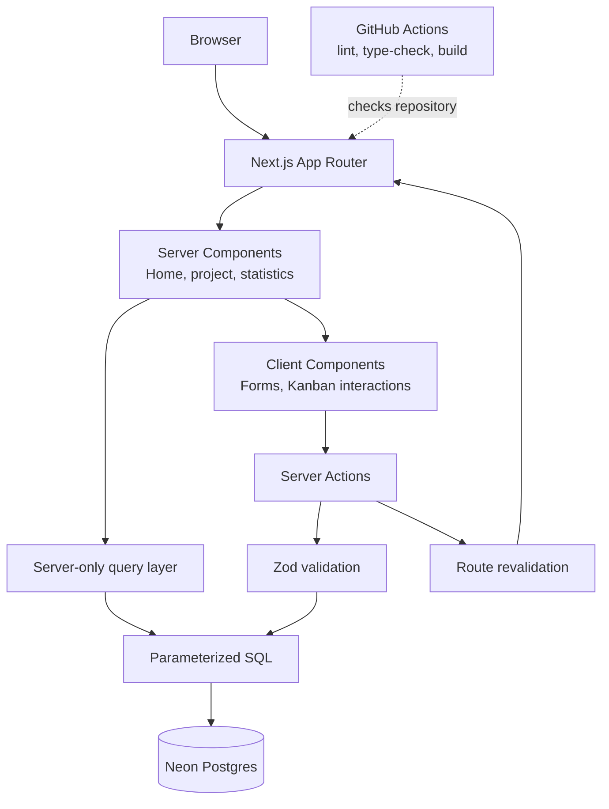
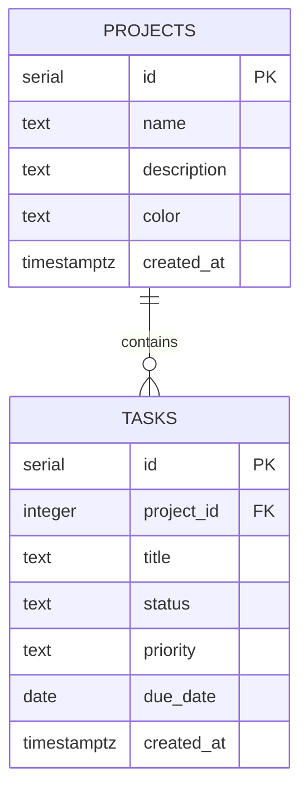

# Project Tracker

[](https://github.com/hussainibabangida20-ai/16-project-tracker/actions/workflows/ci.yml)

## Case study

Project Tracker is a responsive workspace for organizing projects and their tasks in one place. Users can create and color-code projects, manage tasks on a three-stage Kanban board, set priorities and due dates, search and filter tasks, and review workspace-wide progress and overdue work. The app is built with Next.js App Router and TypeScript, with Neon Postgres for persistence and Zod validation at the server-action boundary. The repository includes a GitHub Actions workflow for linting, type-checking, and production builds. **Live demo:** not yet configured in this repository; add the production URL here when one is available.

**Repository:** [hussainibabangida20-ai/16-project-tracker](https://github.com/hussainibabangida20-ai/16-project-tracker)

### Problem → solution

When project plans and task status are scattered across notes or spreadsheets, it is difficult to see what is in progress, what is blocked by a due date, and how much work is complete. Project Tracker brings those details into a single workspace: projects group tasks, a Kanban board makes status visible and editable, and statistics summarize completion, priorities, and overdue tasks.

### Features

- Create projects with a name, description, and custom color; remove projects when they are no longer needed.
- Add tasks with a status, priority, and optional due date.
- Move tasks between To do, Doing, and Done, with optimistic UI updates.
- Search task titles and filter by priority using shareable URL query parameters.
- See project completion progress and workspace-wide task, status, priority, and overdue summaries.
- Validate writes on the server and show form or action errors when a mutation fails.
- Run lint, type-check, and production-build checks in GitHub Actions for pull requests and pushes to `main`.

### Screenshots

> **Dashboard placeholder:** Add a screenshot of the project overview at `screenshots/dashboard.png`.

> **Kanban board placeholder:** Add a screenshot of a project board at `screenshots/kanban-board.png`.

> **Statistics placeholder:** Add a screenshot of the workspace statistics at `screenshots/statistics.png`.

### Tech stack — and why

| Technology | Why it is used |
| --- | --- |
| Next.js 15 App Router | Provides route-based pages, server rendering, and server actions in one application framework. |
| React 19 | Builds the interactive forms and Kanban board; its optimistic-state and transition APIs support responsive task updates. |
| TypeScript | Makes task, project, and action-state shapes explicit across server and client code. |
| Tailwind CSS 4 | Enables consistent responsive layouts and component styling without a separate CSS component framework. |
| Neon Postgres and `@neondatabase/serverless` | Store relational project/task data in managed Postgres and access it through a serverless-friendly SQL client. |
| Zod | Validates and normalizes untrusted form values, IDs, enum values, colors, and calendar dates at runtime. |
| GitHub Actions | Automatically runs lint, type-check, and build checks on pull requests and pushes to `main`. |

### Architecture

The App Router pages render project and statistics data on the server. Server Components read through server-only query functions; client forms and the Kanban board submit mutations to Server Actions. Those actions validate input before parameterized SQL writes, then revalidate affected routes. GitHub Actions checks code quality and buildability; this repository does not currently define a deployment workflow.



### Data model

Each task belongs to one project. Deleting a project cascades to its tasks. Task status and priority are constrained to the values used by the board and filters.



### Security considerations implemented

- Server Action inputs are parsed with Zod, including positive integer IDs, allowed task states and priorities, bounded text fields, hex colors, and valid calendar dates.
- Database reads and writes use Neon’s tagged-template SQL interface with bound values rather than interpolating user input into SQL text.
- Task mutations constrain both the task ID and its parent project ID, preventing a task operation from silently targeting a task in another project.
- Database constraints enforce required fields, length limits, valid status and priority values, and cascading task deletion.
- The database client and query module are marked `server-only`; `DATABASE_URL` is read from the server environment and is not included in client code.
- `next.config.ts` disables the `X-Powered-By` header and sets CSP, HSTS, content-type, framing, referrer, and permissions-policy headers.
- GitHub Actions uses read-only `contents` permissions for its CI job.

**Important limitation:** this codebase does not implement user authentication or authorization. Project and task data is not scoped to a signed-in user, so do not use this version with private or multi-user data until access control and ownership checks are added. No GitHub OAuth implementation or production deployment configuration was found in the repository when this case study was written.

### Challenges and what I learned

- **Keeping mutations within the right project:** validating IDs is not enough on its own. Scoping task updates and deletes by both task and project IDs makes the relationship part of the database operation.
- **Making the board feel responsive without hiding failures:** optimistic status changes improve perceived speed, while action results and visible error messages keep failed updates from looking successful.
- **Getting useful summaries from relational data:** aggregate counts, filtered counts, and overdue-task queries let the statistics page derive a workspace overview from the same project/task model.
- **Treating form values as untrusted:** runtime validation complements TypeScript because browser-submitted values are not guaranteed to match compile-time types.
- **Separating checks from deployment:** the CI workflow verifies lint, types, and build output, but a successful build is not itself a production deployment. Hosting and production configuration still need to be set up and verified.

### Future improvements

- Add authentication and authorization, associate each project with its owner, and enforce ownership in every read and mutation.
- Configure and verify a production deployment, then replace the demo notice above with its public URL.
- Add automated tests for validation, server actions, query behavior, and key user flows.
- Capture and add real dashboard, board, and statistics screenshots.
- Add pagination or other scalable query strategies as workspaces grow.
- Improve task movement with drag-and-drop while retaining keyboard-accessible controls.

## Run locally

1. Install Node.js 20 or newer.
2. Create a Neon project and database in the [Neon Console](https://console.neon.tech/), then copy its connection string.
3. Copy `.env.example` to `.env.local` and set `DATABASE_URL` to your Neon connection string. Keep `.env.local` private; it is ignored by Git.
4. Apply [`schema.sql`](./schema.sql) to your Neon database using the Neon SQL Editor or `psql`. This creates the tables and example records.
5. Install dependencies and start the development server:

   ```sh
   npm install
   npm run dev
   ```

6. Open [http://localhost:3000](http://localhost:3000).

## Validation and production

```sh
npm run lint
npm run typecheck
npm run build
npm start
```

Set `DATABASE_URL` in the deployment environment before deploying. `next.config.ts` applies security headers to all routes, including a content security policy. Inline scripts and styles are permitted for Next.js rendering and the app's color styling; avoid adding third-party scripts without updating that policy.
